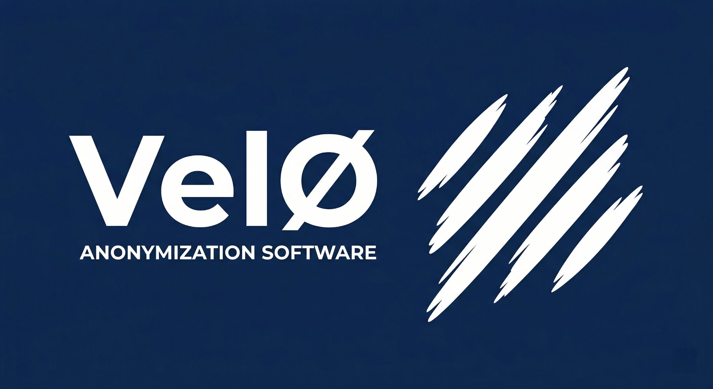

<p align="center">
  
</p>
# Velo

Herramienta local para archiveros y profesionales de la gestión documental orientada a **detectar, revisar y redactar** datos sensibles en documentos.

## Posicionamiento del proyecto

Velo está concebido para **uso personal y estrictamente local** en el puesto de trabajo del profesional. No es una aplicación pensada para despliegue multiusuario, publicación en red o tratamiento automatizado sin supervisión.

La herramienta **asiste** al proceso, pero **no sustituye la decisión profesional**: cada hallazgo debe ser confirmado, descartado o añadido manualmente por la persona revisora.

## Estado del proyecto

Versión actual del código: **0.6.0**.

Esta revisión deja el proyecto mejor alineado en varias capas:

- versión y requisito de Python unificados;
- instalación aislada mediante entorno virtual local `.venv`;
- sesiones visuales efímeras con poda por antigüedad;
- exportaciones y frontend con trazabilidad de versión consistente;
- aplicación sobre el original solo por acción explícita;
- ejemplo de demo claramente sintético;
- separación entre repositorio fuente y paquete distribuible simplificado.

## Principios de diseño

- **Procesamiento local**: la aplicación escucha en `127.0.0.1`.
- **Revisión humana obligatoria**: Velo detecta y propone; el archivero valida.
- **No altera el máster original**: cuando redacta un PDF, genera una **copia derivada**.
- **Dos salidas PDF**: permite generar una copia visual rasterizada o una copia PDF testada que elimina el contenido subyacente y conserva la capa de texto no afectada.
- **Trazabilidad**: el informe JSON conserva hallazgos, decisiones y metadatos.
- **Persistencia mínima**: los temporales no visuales se eliminan y las sesiones visuales son efímeras.

## Requisitos

- Python **3.11 o superior**.
- Entorno de escritorio local.

## Instalación

### Windows

Ejecuta `install.bat`.

### Linux / macOS

```bash
chmod +x install.sh
./install.sh
```

Los instaladores crean un entorno virtual local `.venv` dentro de la carpeta del proyecto para aislar dependencias y reducir conflictos con el sistema.

La instalación es **verificada**: cada paquete (incluidos pip y el modelo español de spaCy) se instala con la versión exacta y el SHA-256 fijados en `locks/`, y pip rechaza cualquier fichero que no coincida. No se compilan paquetes fuente. Si pip informa de un hash que no coincide, no lo fuerce: avise en el repositorio.

Instalación manual equivalente:

```bash
python -m venv .venv && . .venv/bin/activate        # Windows: .venv\Scripts\activate
python -m pip install --require-hashes --only-binary=:all: -r locks/pip.lock
python -m pip install --require-hashes --only-binary=:all: -r locks/requirements.lock
python -m pip install --require-hashes --only-binary=:all: -r locks/requirements-visual.lock  # opcional: revisión visual PDF
python -m pip install --require-hashes --only-binary=:all: -r locks/requirements-nlp.lock     # opcional: nombres (spaCy + modelo)
python run.py
```

### Qué toca en tu equipo y cómo eliminarlo

Velo solo escribe en su carpeta y en su directorio de datos (Windows:
`%LOCALAPPDATA%\Velo`; macOS: `~/Library/Application Support/Velo`; Linux:
`~/.local/state/velo`), y no se conecta a internet mientras funciona. Para
eliminarlo: apágalo, ejecuta `desinstalar.bat` o `./desinstalar.sh` y borra la
carpeta. Qué se comprueba en cada versión y con qué límites:
[docs/INSTALACION_SEGURA.md](docs/INSTALACION_SEGURA.md).

## Distribución simplificada para usuarios no expertos

No es recomendable deformar la raíz del repositorio fuente para ocultar archivos de desarrollo. En cambio, sí es recomendable generar un **paquete distribuible** distinto, con esta estructura:

```text
Velo/
├─ INSTALAR_VELO.bat
├─ INICIAR_VELO.bat
├─ LEEME_PRIMERO.txt
└─ app/
   ├─ run.py
   ├─ install.bat
   ├─ install.sh
   ├─ requirements.txt
   ├─ requirements-visual.txt
   ├─ requirements-nlp.txt
   ├─ locks/
   └─ velo_engine/
```

Para generar ese bundle se incluye `tools/build_release_bundle.py`.

## Ganchos locales recomendados

Para reducir el riesgo de volver a versionar material sensible:

```bash
git config core.hooksPath .githooks
```

El hook incluido bloquea commits accidentales de `workspace/`, `.env`, `.venv/`, `*.log`, `original.pdf`, `visual.json` y `page_*.png`.

## Seguridad y privacidad

Consulta [`SECURITY.md`](SECURITY.md).

## Licencia

Velo se distribuye bajo la **GNU Affero General Public License v3 o posterior** (AGPL-3.0-or-later). Ver [`LICENSE`](LICENSE).

Copyright (C) 2026 Víctor Villapalos Pardiñas.
